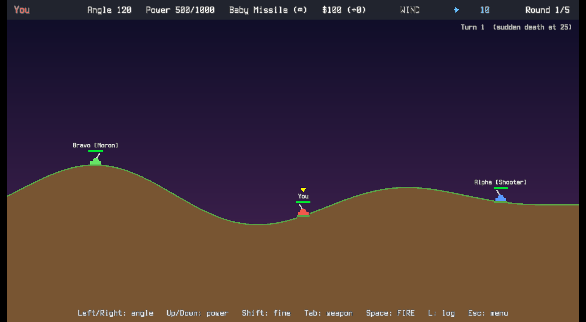
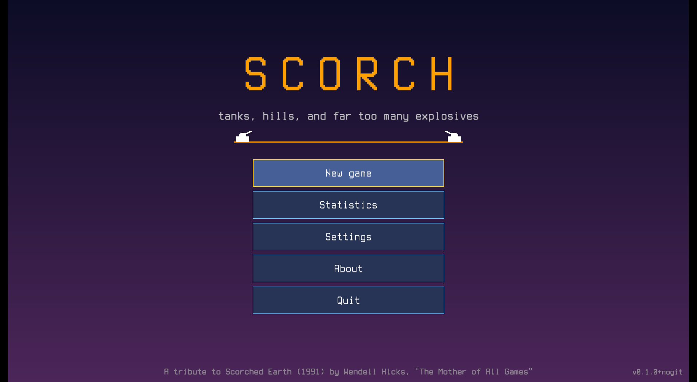
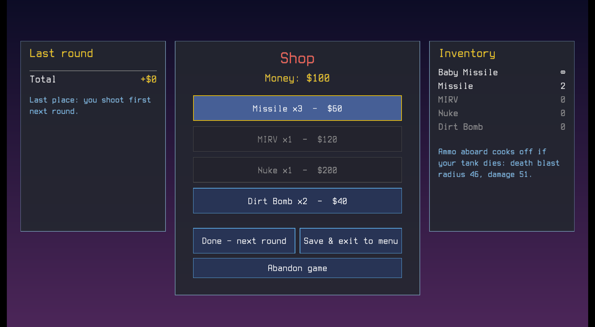
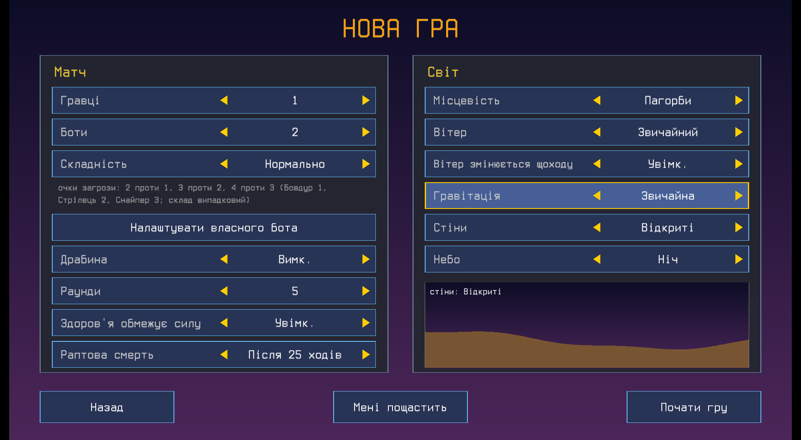

# Scorch

[](https://github.com/vovinacci/scorch-game/actions/workflows/ci.yml)
[](https://github.com/vovinacci/scorch-game/releases/latest)
[](LICENSE)

**Tanks, hills, and far too many explosives.**

Scorch is a turn-based artillery game for one or two players against up to three computer opponents. Aim, mind the wind,
fire, and blow the hills (and everyone on them) apart. It's a tribute to *Scorched Earth* (1991) by Wendell Hicks, "The
Mother of All Games".

*In memory of Joseph Rivkind (1952–2026), who taught me to never stop learning.*



## Features

- **Destructible terrain:** every explosion digs a crater, tanks fall into them, and wrecks stay where they land.
- **Wind and gravity** that change how every shot flies, plus four terrain types (or a random one), four kinds of walls
  and three skies.
- **Five weapons**, from the free Baby Missile to the Nuke and the MIRV, which splits into five warheads. The Dirt Bomb
  buries your enemies.
- **Chain reactions:** a destroyed tank explodes, and the ammo it carries makes the blast bigger.
- **Bots that learn to aim like people do:** they miss at first, then close in shot by shot. They take revenge, pick on
  the weak or go after the leader. Three skills, four difficulties, or design your own bot.
- **A shop between rounds**, with catch-up rules so one bad round doesn't decide the game.
- **Hotseat:** two players at one keyboard.
- **Battle log** of every shot, hit and kill, and why each bot picked its target.
- **Saves automatically:** close the window any time and continue later.
- **Languages:** English and Ukrainian.
- Plays well with the keyboard alone; the mouse works too. Fits any window size and works fullscreen.

| | |
|---|---|
|  |  |
|  | |

## Getting started

### Download

Get the latest version from [Releases](https://github.com/vovinacci/scorch-game/releases/latest):

| System | File |
|---|---|
| Windows | `scorch-...-windows-x86_64.zip` (or `aarch64` for ARM laptops): unzip, run `scorch.exe` |
| macOS | `scorch-...-macos.zip`: unzip, move `Scorch.app` to Applications |
| Linux | `Scorch-....AppImage`: make it executable and run it; or the `.tar.gz` |

### System requirements

- **Windows** 10 or newer, x86_64 or ARM64. Nothing else to install.
- **macOS** 11 (Big Sur) or newer, Intel or Apple Silicon.
- **Linux** x86_64 or ARM64 with glibc 2.35 or newer (Ubuntu 22.04, Debian 12, Fedora 36 or newer) and OpenGL. The game
  uses X11; on Wayland desktops it runs through XWayland. It needs these libraries, which almost every desktop already
  has:

  | Distribution | Packages |
  |---|---|
  | Debian, Ubuntu | `libx11-6 libxi6 libxkbcommon0 libgl1` |
  | Fedora | `libX11 libXi libxkbcommon libglvnd-glx` |
  | Arch | `libx11 libxi libxkbcommon libglvnd` |

The builds aren't code-signed yet, so the first start shows a warning. Windows: "More info", then "Run anyway". macOS:
right-click `Scorch.app`, then "Open".

### Build it yourself

It takes a few minutes the first time.

1. Install [Rust](https://www.rust-lang.org/tools/install) (version 1.88 or newer; with [mise](https://mise.jdx.dev),
   the pinned version installs itself).
2. On Linux, make sure the usual graphics libraries are installed (X11 or Wayland, and OpenGL). On NixOS, `make` takes
   care of this through `nix-shell`.
3. In this folder, run:

   ```text
   make release
   ```

   The game builds and starts. Next time, the same command starts it right away.

## How to play

Choose **New game**, then **Start game**. Aim with the arrow keys, fire with Space, and destroy the other tanks before
they destroy you.

The **player's guide** explains everything else: controls, the wind, weapons, money, how the bots think and every
option.

- [Player's guide (English)](docs/GUIDE.md)
- [Посібник гравця (українською)](docs/GUIDE.uk.md)

## Languages

Scorch is available in:

- English
- Українська (Ukrainian)

On the first start the game picks your computer's language if it has it, otherwise English. Change it any time in
**Settings**: the language option is always the first row, marked with a globe and "Language / Мова", so you can find it
even in a language you can't read.

Want to add a language? All the game's text is in plain text files in [`assets/i18n/`](assets/i18n/). Copy `en-GB.ftl`,
translate the text after each `=`, and get in touch; the [development notes](docs/DEVELOPMENT.md#translations) explain
the details.

## Saves and settings

Your saved game, settings and statistics are kept in your user data folder, for example `~/.local/share/scorch/` on
Linux. Deleting that folder resets the game.

## Reporting problems and contributing

If the game crashes, it saves a report and offers to copy it the next time you start it. Please
[open a bug report](https://github.com/vovinacci/scorch-game/issues/new/choose) with the report, or describe what
happened, together with the version number from the bottom right of the main menu. The game never sends anything by
itself.

Ideas, translations and code are welcome too: see [CONTRIBUTING.md](CONTRIBUTING.md).

## For developers

Building, tests, the exact rules and numbers, and a map of the code are in the [development notes](docs/DEVELOPMENT.md).
Plans are in the [roadmap](docs/ROADMAP.md).

## Credits

- Made with ♥ by Volodymyr Shcherbinin (vovin), in Rust, using [macroquad](https://macroquad.rs/).
- Inspired by *Scorched Earth* (1991) by Wendell Hicks.
- Font: Scorch Mono, based on [Terminus](https://terminus-font.sourceforge.net/) by Dimitar Zhekov, under the SIL Open
  Font License ([details](assets/fonts/README.md)).

## Licence

Scorch is free software under the [MIT License](LICENSE): you may use, change and share it, as long as the copyright
notice comes along. The font has its own licence, the [SIL Open Font License](assets/fonts/LICENSE-OFL.txt).
